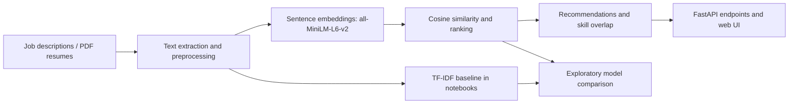

# SmartHire AI | Intelligent Job & Resume Matching

**NLP · Sentence Transformers · Semantic Similarity · TF-IDF · FastAPI · Python**

A recruitment-oriented **AI demonstration and notebook project** supporting two workflows: ranking CVs for a job description (**Employer Mode**) and recommending job postings from a CV (**Job Seeker Mode**). The research notebooks explore sentence embeddings, cosine similarity, job/resume preprocessing, skill extraction and a TF-IDF baseline. A separate FastAPI + HTML/CSS/JavaScript demo exposes the two workflows.

> **Scope:** This repository contains original research notebooks and a runnable *small-data* web demo. It **does not** contain the full Kaggle job dataset, PDF resume collection, or trained model weights. The web demo ships with a six-row example `jobs.csv` and is **not a deployment of the full 1.6M-row notebook dataset**. The notebook code, data paths and application code are preserved from the submitted project.

## 1. Business Problem & Objectives

Reviewing large numbers of CVs and job descriptions by hand can be slow; keyword-only matching can overlook semantic relationships. This project demonstrates whether a sentence-embedding model can help:

- Rank uploaded candidate CVs against an employer's job description.
- Recommend roles matching the content of a job seeker's CV.
- Display similarity-based scores and matched/missing skills as supporting information.
- Compare semantic similarity with a classical TF-IDF baseline in the notebooks.

**These results are decision-support signals, not validated hiring decisions or probabilities of candidate success.**

## 2. Project Workflow



The notebook and web demo implement related ideas **independently**. The notebooks use the large Kaggle job data and resume documents; the demo uses its own bundled six-row example dataset by default.

## 3. Dataset Sources & Grain

| Source | Link | Used for | GitHub inclusion |
|---|---|---|---|
| Job Description Dataset — Ravinder Singh Rana | [Kaggle dataset](https://www.kaggle.com/datasets/ravindrasinghrana/job-description-dataset) | Job descriptions and job/company attributes in notebooks | **Download separately** |
| Resume Dataset — Snehaan Bhawal | [Kaggle dataset](https://www.kaggle.com/datasets/snehaanbhawal/resume-dataset) | PDF CV parsing and candidate matching | **Download separately** |
| Example web demo jobs | [`backend/data/jobs.csv`](backend/data/jobs.csv) | FastAPI job-seeker demo; **6 example jobs** | Included |

The full job dataset is approximately **1,615,940 job rows × 23 columns** in the saved output of `Job.ipynb`. Its grain is a **job posting**. CV-based workflows treat a resume as a candidate document; scoring is by CV/job pair. The raw Kaggle datasets must be acquired and used under their respective source terms. **Do not upload real applicants' CVs or private contact information as demo input to a public repository.**

## 4. Technology Stack

| Component | Implementation |
|---|---|
| NLP representation | Pretrained `all-MiniLM-L6-v2` (`sentence-transformers`) |
| Semantic scoring | Cosine similarity on text embeddings |
| Baseline in research notebook | TF-IDF + cosine similarity |
| Processing | Python, pandas, NumPy, regex, spaCy (in exploratory notebooks) |
| CV ingestion | PyMuPDF / `pymupdf` |
| Web demo API | FastAPI, Uvicorn, Python multipart upload |
| Web UI | HTML, CSS, vanilla JavaScript |
| Notebook execution | Jupyter, with a separate Google Colab notebook |

The pretrained model is **used for embeddings; it was not fine-tuned or trained from scratch in this project**. If `sentence-transformers` is unavailable at import time, the provided FastAPI code uses a TF-IDF fallback. On first use of the embedding model, internet access may be needed to download weights.

## 5. Data Preparation & Analytical Choices

The supplied notebooks demonstrate several preparatory steps; not every step is shared by every notebook:

- **Job / company splitting:** `Job.ipynb` divides job-posting attributes into job and company tables using the original `Job Id`; the main Colab notebook also exports `Jobs.csv` and `Companies.csv`.
- **Dates:** job posting dates are parsed into a `Date` field and the source posting-date column is dropped in the derived jobs data.
- **CV handling:** PDF text is extracted; helper functions normalize casing, whitespace and unwanted characters in some workflows.
- **Job matching:** candidate/job texts are embedded, compared with cosine similarity and ranked by score.
- **Skills:** skills are extracted or matched from text to display overlap and missing requirements. The implementation uses lightweight parsing and should not be interpreted as a comprehensive skill taxonomy.

**Trade-offs:** Sentence embeddings can capture semantic relatedness but are more resource-intensive than TF-IDF. A lightweight skill matcher is straightforward to demo but may match partial words and miss synonyms. A six-job demo enables easy local testing but is not evidence of ranking quality on the full source dataset.

## 6. Research Notebooks

| Notebook | What it demonstrates |
|---|---|
| [`Job.ipynb`](notebooks/Job.ipynb) | Load the Kaggle jobs data; explore schema and split into jobs/companies; export jobs CSV |
| [`cv.ipynb`](notebooks/cv.ipynb) | PDF resume extraction, text cleanup, exploratory skill extraction |
| [`Model.ipynb`](notebooks/Model.ipynb) | Sentence embeddings and job-description matching / ranking |
| [`Employers.ipynb`](notebooks/Employers.ipynb) | Embedding-based employer-side ranking of multiple PDF CVs |
| [`week6(DL)done_(1)finaaal (2).ipynb`](notebooks/week6%28DL%29done_%281%29finaaal%20%282%29.ipynb) | Google Colab notebook combining both workflows, skill gap, TF-IDF comparison, exploratory error analysis |

**Portability:** The original notebooks still contain local Windows paths and the main notebook uses `/content/drive/MyDrive/job_descriptions.rar`. These paths were **deliberately not changed**. To reproduce them, download the two Kaggle datasets, prepare the required `Jobs.csv` / `Companies.csv` where applicable, and adjust paths for your own system or place files at the expected location. The main Colab notebook expects a RAR archive named `job_descriptions.rar` containing `job_descriptions.csv` at its root, mounted under `MyDrive`. Kaggle downloads may arrive as ZIP or CSV; the archive and folder structure must match the notebook's expectations. The original notebooks have not been rerun end-to-end as part of this repository packaging.

Saved outputs containing identifiable resume or contact details have been removed from three notebook cells for publication. **The code and paths themselves are unchanged.**

## 7. Model Comparison & Evaluation Caveat

The final notebook includes a **manual, exploratory top-five relevance labeling example**:

| Check | Semantic ranking | TF-IDF ranking |
|---|---:|---:|
| Manually marked relevant in five surfaced results | 3 / 5 | 2 / 5 |
| Descriptive `Precision@5` from those labels | 60% | 40% |

These numbers come from *one small manually labeled example*, not from a held-out relevance dataset. The notebook also prints Recall = 100% and F1 scores, but its calculation marks **all five retrieved recommendations as predicted positive**, so no unreturned relevant jobs are considered; the resulting Recall and F1 values **do not demonstrate true retrieval recall**. In addition, duplicated job descriptions in top results make label consistency important. Do not generalize this example into verified model superiority or production-level accuracy.

A more convincing offline evaluation would require a labeled query–document relevance set and ranking metrics such as `Precision@K` and `nDCG@K`. No such benchmark is claimed here.

## 8. Demo Features & API

### Job Seeker Mode
Upload a PDF CV to rank jobs from the **bundled six-row demo file**, with match scores and simple skill-overlap feedback.

### Employer Mode
Provide a job description and upload one or more PDF CVs to rank candidates by text similarity, with matched/missing skill indicators.

| Route | Method | Function |
|---|---|---|
| `/health` | GET | Reports service status / selected scoring backend |
| `/jobseeker/recommend` | POST | Accepts a PDF resume and optional filters; returns recommended jobs |
| `/employer/rank` | POST | Accepts a job description and PDFs; returns candidate ranking |
| `/docs` | GET | FastAPI auto-generated interactive API documentation |

### Run the web demo locally

**Prerequisite:** Python (project originally used Python 3.13 artifacts; dependencies may need a compatible Python environment), `pip`, and internet for installing dependencies and potentially retrieving model weights.

```bash
cd backend
python -m venv .venv
# Windows
.venv\Scripts\activate
# macOS / Linux
# source .venv/bin/activate
python -m pip install -r requirements.txt
uvicorn main:app --reload
```

Visit [http://127.0.0.1:8000/docs](http://127.0.0.1:8000/docs) to inspect the API. Open `frontend/index.html` with a local web server (such as the VS Code Live Server extension). The UI calls `http://127.0.0.1:8000` by default. See [`docs/ORIGINAL_RUN_INSTRUCTIONS.md`](docs/ORIGINAL_RUN_INSTRUCTIONS.md) for the supplied launch guide.

**Demo safety:** This is a local development app, not a hardened public recruitment service. It uses permissive CORS and basic PDF handling; do not deploy publicly or use real applicant data without further privacy, security and bias review.

### Work with the notebooks

Install additional research notebook packages if needed:

```bash
python -m pip install -r requirements-notebooks.txt
```

The `week6...ipynb` notebook is designed for **Google Colab** (it imports `google.colab` and mounts Google Drive); installing local requirements alone will **not** make that notebook immediately portable. Download dataset files separately, set up the archive/paths described above, and check the notebook cells before running them.

## 9. Repository Structure

```text
SmartHire-AI/
├── README.md
├── .gitignore
├── requirements-notebooks.txt
├── backend/
│   ├── main.py
│   ├── requirements.txt
│   ├── README.md
│   └── data/jobs.csv             # 6 example jobs
├── frontend/
│   ├── index.html
│   ├── jobseeker.html
│   ├── employer.html
│   ├── methodology.html
│   ├── script.js
│   └── styles.css
├── notebooks/
│   ├── Job.ipynb
│   ├── cv.ipynb
│   ├── Model.ipynb
│   ├── Employers.ipynb
│   └── week6(DL)done_(1)finaaal (2).ipynb
└── docs/
    └── ORIGINAL_RUN_INSTRUCTIONS.md
```

## 10. Team & Individual Contributions

**SmartHire AI was developed collaboratively.** The AI and NLP research components were a shared effort, while the repository owner independently developed the application frontend and backend.

| Contributor | Actual contribution |
|---|---|
| **Repository owner** *(add name and GitHub profile)* | **Joint:** data preprocessing, Jupyter notebooks, NLP experiments and model implementation. **Independent:** FastAPI backend, HTML/CSS/JavaScript frontend, and integration of the matching functionality into the application. |
| **AI project collaborator** *(add name and GitHub profile)* | **Joint:** data preprocessing, Jupyter notebooks, NLP experiments and AI model development. |

**Credit allocation:** The AI/ML work is **shared**, and the web application's **frontend and backend were developed by the repository owner**. These role descriptions reflect the contributors' stated responsibilities; they do not imply separate ownership of the shared AI work.

> **Before publishing:** Replace the two contributor placeholders with the correct names and GitHub profile links. If the collaborator has a GitHub account, you can also invite them as a repository collaborator after creating the repository; this is separate from authorship attribution.

## 11. Limitations & Responsible Use

- The notebook's manually labeled five-result comparison is **not** an independent benchmark of retrieval quality.
- The demo's six jobs are a **sample for functionality**, not a representative evaluation corpus.
- Similarity scores are **ranking signals**, not calibrated probabilities, candidate merit ratings or guarantees of job suitability.
- Simple skills parsing can have false positives/negatives.
- Full CV datasets can contain personal information: only sources are linked here; do not commit sensitive CV files, user uploads or secrets.
- Hiring systems can introduce or reinforce unfair treatment. Human judgment, explicit job-related criteria, privacy safeguards and fairness testing are required before any real-world use.

---

**Data attribution:**
- [Snehaan Bhawal — Resume Dataset (Kaggle)](https://www.kaggle.com/datasets/snehaanbhawal/resume-dataset)
- [Ravinder Singh Rana — Job Description Dataset (Kaggle)](https://www.kaggle.com/datasets/ravindrasinghrana/job-description-dataset)

**Status:** Portfolio / research prototype and local demo; original ML and application code retained.
